# Devin Factory design — 0.1.0

A Warp-Factories-style software factory with one long-lived foreman per Linear issue and one isolated child
per stage. The plugin is prompts, contracts and deployment drafts, not a daemon or an installed automation.
Linear is the durable database; conversations are recoverable execution contexts.

## Pilot and state model

MANM (Manager Mobile App, 0bab2835-3ed3-4089-bed2-129d6febe92c) routes to vmm and/or scarlet iOS/Android.
EMPM (Employee Mobile App, e00b3530-814b-434d-8b72-e87c05c32b4f) routes to scarlet iOS/Android only.
Canonical repository names and gates live in factory-repo-gates.

Existing workflow states remain Backlog, Todo, In Progress, In Review, Done, Canceled, Duplicate.
Single-select Factory labels track intake, triage, spec, spec-review, build, review, human-review, blocked,
done, failed. Single-select Factory signal labels approve, answered, revise, stop are human-only inputs.
Triage/spec/spec-review map to Todo; build to In Progress; review/human-review to In Review; done to Done.
Blocked and failed leave status unchanged. No new workflow states are created.

One comment starts with `<!-- factory-state -->` then fenced JSON. It contains exactly version, issue,
foreman, stage, size, repos, children (triage/spec/build/review), spec_doc, pr, review_rounds, last_signal,
updated_at. See schemas/state.json and factory-linear-state for exact types and update rules.
pr is a repo-to-PR-URL map so multi-repo issues do not lose merge tracking; spec_doc is a Linear Document URL.
Normal comments hold stage summaries, decisions, resume targets and human questions.
Every foreman checkpoint/status comment includes: "Stuck for a few hours? Add Factory signal › answered to nudge."
The state comment is updated with save_comment id, never replaced with new state comments.
There is no cross-service transaction/CAS: owner checks, state-first transitions, reconciliation and
idempotent artifact lookups minimize races, but ambiguous ownership is blocked for human resolution.

## State diagram

```mermaid
stateDiagram-v2
    [*] --> intake: human adds Factory intake
    intake --> triage: claim foreman
    triage --> spec: M/L or needs_spec
    triage --> build: S and no spec needed
    triage --> blocked: questions
    spec --> blocked: questions / failure
    spec --> spec_review: attached Linear Document
    spec_review --> spec: revise existing child
    spec_review --> build: approve document revision
    build --> review: PRs and gate evidence
    build --> blocked: missing decision / gate
    review --> build: revise and rounds below 2
    review --> human_review: accept / human / round 2
    human_review --> build: human revise existing child
    build --> human_review: review cap already reached
    human_review --> done: all PRs verified merged
    blocked --> triage: answered; resume recorded target
    blocked --> spec: answered; resume recorded target
    blocked --> build: answered; resume recorded target
    intake --> failed: stop / terminal failure
    triage --> failed: stop / terminal failure
    spec --> failed: stop / terminal failure
    spec_review --> failed: stop / terminal failure
    build --> failed: stop / terminal failure
    review --> failed: stop / terminal failure
    human_review --> failed: stop / terminal failure
    blocked --> failed: stop / terminal failure
    done --> [*]
    failed --> [*]
```

spec_review and human_review in the diagram are the spec-review/human-review labels, not workflow states.
Stop cancels children and marks Factory failed with "stopped by human", preserving workflow status.

## Execution and human authority

Foreman never codes. Each child returns a draft-07 structured contract. Spec child saves a Linear Document
attached with save_document issue, not a PR. Only S and needs_spec=false skips spec. Every spec revision
requires human approve before build. Reviews are independent from build and limited to two completed
rounds total; revisions go to the same build child via message. At the cap remaining findings go to humans.
The existing review child is messaged for the second review; no third automatic round.

Every run reaches human-review, even Android. iOS and vmm always require human merges.
Android build child may auto-merge only after human-review approve, accepted current-head review, and all
required successful checks including ui-smoke, subject to branch protection. This is an intentional
conservative interpretation of "always human checkpoint"; approve is not required for a human's own merge.
A post-cap revision requires human merge, since no further independent automatic review is available.
A closed-unmerged PR is not done. Multi-repo runs become done only after every recorded routed PR merges.

## Waking and recovery

- A1: linear:label_added intake, filtered to MANM, starts/resumes foreman.
- A2: MANM linear:label_added approve/answered/revise/stop messages its standing Lite dispatcher;
  it messages the live owner or starts a fresh foreman only if the owner is verified gone/finished.
- A3: github:pull_request closed + merged + factory/ head messages its standing Lite dispatcher.
  Resolve the recorded issue; foreman verifies GitHub and all PRs before done/Done.
- Waiting foreman arms a two-hour devin_reminder_manage reminder as fallback. Child creation uses
  notify_on_response=true, so child results wake it without polling.

A2/A3 use message_session with auto_create: true, one dispatcher per automation, not a new relay per event.
Dispatchers re-read Linear per event and return to waiting.
Relays never consume signals; only the foreman records a receipt, removes the label and acts.
Recovery is human-triggered: add Factory signal › answered (or any human signal) to wake the owner or
restart a verified finished/unreachable foreman from nonterminal state. With no pending question,
answered is a nudge/resume signal: reconcile current state and continue, never approve or bypass a gate.
With a pending question, actual answers are still required. done/failed remains a no-op without new-run
authorization. Missing state or uncertain liveness blocks recovery; never create a duplicate owner.
New owners recover child outputs, specs, PRs and review count instead of starting over.
Partial writes reconcile from state; ambiguous side effects are inspected before retry. A waiting owner is live.
Missing child/resume capabilities are blocked, not an excuse to duplicate a writer.

## Runtime boundary and non-goals

runtime/devin.md maps stages to devin_session_create / devin_session_interact, native MCP and reminders.
runtime/claude.md maps them to resumable Task subagents and git worktrees, with Linear/GitHub in .mcp.json.
Claude local wake-up is manual or explicitly externally scheduled; it cannot impersonate cloud automations.
Both runtimes share the skills, schemas and safety policies. Agent profiles inherit host MCP availability.

Automation JSONs are unapplied, disabled drafts. Live API envelope/DSL details and event bindings remain
PLACEHOLDERs to validate before deployment. No workflow/label setup, live automations, production writes,
self-improvement scorer, secrets management or repository CI policy changes are performed by installation.
Costs are bounded by reviewed automation and child budgets, not unlimited autonomous retries.
